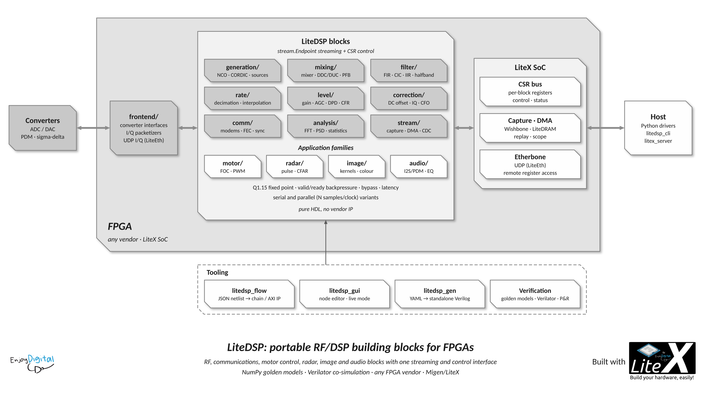

```
                                     __   _ __      ___  _______
                                    / /  (_) /____ / _ \/ __/ _ \
                                   / /__/ / __/ -_) // /\ \/ ___/
                                  /____/_/\__/\__/____/___/_/

                                   Copyright 2026 / Enjoy-Digital

                             Portable RF/DSP building blocks for FPGAs
                                      powered by Migen & LiteX

                           Work In Progress: APIs/blocks can still move!
```

[](https://github.com/enjoy-digital/litedsp/actions)  [](https://deepwiki.com/enjoy-digital/litedsp)

**🚧 Work In Progress**: LiteDSP is under active development: block interfaces, parameter names
and repository layout can still move/change until the first stable release. Feedback is very
welcome!

[> Intro
--------

LiteDSP provides a toolbox of portable, well-tested RF/DSP building blocks for FPGA, written in
Migen/LiteX. Every block is pure HDL (no vendor IP), so it simulates end-to-end and runs on any
FPGA, and every block shares one standardized streaming + control interface so blocks compose by
`connect()`.

LiteDSP is part of LiteX libraries whose aims are to lower entry level of complex FPGA cores by
providing simple, elegant and efficient implementations of components used in today's SoC such as
Ethernet, SATA, PCIe, SDRAM Controller...

The core can be used as a LiteX library or can be integrated with your standard design flow by
generating the Verilog RTL that you will use as a standard core (see the Generator and Flow
tooling below).

It covers RF processing (mixers, NCO, filters, rate conversion, gain/AGC, corrections, analysis),
digital communications, motor control, radar/sonar, image/video and audio processing, and is a
clean base to customize from.

[> Features
-----------

- **Portable**: pure Migen/LiteX, no vendor IP, fully simulatable.
- **One interface**: LiteX streams with valid/ready backpressure, the same CSR control pattern
  (`with_csr=True`), `bypass` and a declared `latency` on every block.
- **Fixed point**: parameterized Qm.n format (Q1.15 by default), shared rounding, saturation and
  scaling helpers.
- **Tested**: NumPy golden models, bit-exact or SNR checks, Verilator co-simulation under
  randomized backpressure.



[> Blocks
---------
About 230 blocks, all named `LiteDSP<Name>`. One datasheet per block (parameters, ports, registers,
resources) in the [block catalogue](doc/blocks/index.md).

| Family        | Content                                                                        |
|---------------|--------------------------------------------------------------------------------|
| `generation/` | NCO/DDS, CORDIC, chirp, noise, replay and test pattern sources                 |
| `mixing/`     | Complex mixer, DDC, DUC, channelizers (DDC bank, polyphase filter bank)        |
| `filter/`     | FIR, CIC, half-band, IIR biquads, resamplers, Hilbert, pulse shaper, equalizer |
| `rate/`       | Downsampler, upsampler, decimator, interpolator, multi-channel resampler       |
| `level/`      | Gain, AGC, power, RMS, log, saturation, clipper, squelch, DPD, CFR             |
| `correction/` | DC offset, I/Q balance, frequency offset derotator                             |
| `comm/`       | Modulators and demodulators, mappers, coding (Viterbi, Reed-Solomon, LDPC, BCH), synchronization (PLL, Costas, timing recovery, frame sync), OFDM |
| `analysis/`   | Window, FFT, PSD, Goertzel, statistics, histogram, peak and frequency estimators, error counter |
| `stream/`     | Combine, split, delay, FIFO, clock domain crossing, framing, timestamps, capture, DMA |
| `frontend/`   | ADC/DAC and bitstream interfaces, I/Q packets for LitePCIe and LiteEth UDP      |
| `motor/`      | Clarke/Park, PI and d/q controllers, SVPWM, PWM, encoders, observers, FOC      |
| `audio/`      | I2S/TDM, PDM, sigma-delta, EQ, compressor, volume, effects, meters, dither     |
| `radar/`      | Range gate, pulse compression, MTI, Doppler, CFAR, peak extraction, trackers, beamformer |
| `image/`      | Line buffers, 2D kernels, Sobel, rank filters, debayer, colour, scaling, statistics, overlay |

Several blocks also exist as parallel variants (`LiteDSPParallel<Name>`): N samples per clock, for
sample rates above the fabric clock, bit-identical to the serial blocks.

[> Tooling
----------

| Tool                  | What it does                                              | Run |
|-----------------------|-----------------------------------------------------------|-----|
| Flow (`flow/`)        | JSON netlist to chain Verilog, CSR map and AXI IP core    | `litedsp_flow flow.json` |
| GUI (`gui/`)          | Node editor for flow netlists, live tuning of a running SoC | `litedsp_gui` |
| Generator (`gen.py`)  | YAML to standalone Verilog core and CSR maps              | `litedsp_gen config.yml` |
| Software (`software/`) | Host drivers over `litex_server`                         | `litedsp_cli info` |
| Examples (`examples/`) | Assembled chains (DDC/DUC, spectrum analyzer, FM/QPSK receivers) | `python3 examples/fm_receiver.py` |
| Sim (`sim/`)          | Verilator co-simulation against the NumPy models          | `python3 sim/run_blocks.py` |
| Impl (`impl/`)        | Synthesis and P&R (ECP5, Artix-7, Artix UltraScale+) against budgets | `python3 impl/run.py --device ecp5` |
| Formal (`formal/`)    | SymbiYosys proof of the stream fabric                     | `python3 formal/run_formal.py` |
| Char (`char/`)        | Quality characterization (SFDR, ripple, rejection) against budgets | `python3 char/run_char.py` |
| Tools (`tools/`)      | LiteX coding-style checker                                | `python3 tools/check_style.py` |
| Bench (`bench/`)      | Hardware benches on Arty and Colorlight 5A-75B            | `python3 bench/spectrum.py --board=arty --build` |

[> Getting started
------------------

1. Install Python 3.9+ (CI tests 3.9 and 3.11) and Verilator (for HDL co-simulation).
2. Install LiteX and its ecosystem by following the LiteX Wiki [installation guide](https://github.com/enjoy-digital/litex/wiki/Installation).
3. Install LiteDSP:
```sh
git clone https://github.com/enjoy-digital/litedsp
cd litedsp
python3 setup.py develop --user
```
4. Compose blocks in a LiteX SoC:
```python
from litedsp.generation.nco import LiteDSPNCO
from litedsp.mixing.mixer   import LiteDSPMixer

self.nco   = LiteDSPNCO(data_width=16)
self.mixer = LiteDSPMixer(data_width=16)
self.comb += self.nco.source.connect(self.mixer.sink_b)
```
or generate a standalone Verilog core from a YAML config:
```sh
litedsp_gen examples/ddc_core.yml
```
Assembled-chain demos live in `examples/`.

[> Documentation
----------------
The **RF & Signal Processing Blocks manual** is the reference of the project, from the primers to the integration,
the examples, the debugging and the registers:

- Read it: [PDF](https://github.com/enjoy-digital/litedsp/releases/download/manual-nightly/litedsp_manual.pdf) or
  [HTML](https://github.com/enjoy-digital/litedsp/releases/download/manual-nightly/litedsp_manual.html) (rebuilt nightly).
- Sources and local build: [doc/manual](doc/manual/README.md).
- One datasheet per block (parameters, ports, registers, resources): [doc/blocks](doc/blocks/index.md).

[> Tests
--------

Unit tests are available in `./test/`. To run all the unit tests:
```sh
python3 -m unittest discover -s test -v
```
Tests can also be run individually:
```sh
python3 -m unittest test.test_nco -v
```

[> License
----------

LiteDSP is released under the very permissive two-clause BSD license. Under the terms of this
license, you are authorized to use LiteDSP for closed-source proprietary designs.

Even though we do not require you to do so, those things are awesome, so please do them if
possible:
- tell us that you are using LiteDSP
- put the LiteDSP logo in your documentation
- cite LiteDSP in publications related to research it has helped
- send us feedback and suggestions for improvements
- send us bug reports when something goes wrong
- send us the modifications and improvements you have done to LiteDSP.

[> Support and consulting
-------------------------

We love open-source hardware and like sharing our designs with others.

LiteDSP is developed and maintained by EnjoyDigital.

If you would like to know more about LiteDSP or if you are already a happy user and would like to
extend it for your needs, EnjoyDigital can provide standard commercial support as well as consulting
services.

So feel free to contact us, we'd love to work with you! (and please tell us a bit about your project
so we can quickly see if we can help you or not:)

[> Contact
----------
E-mail: florent [AT] enjoy-digital.fr
